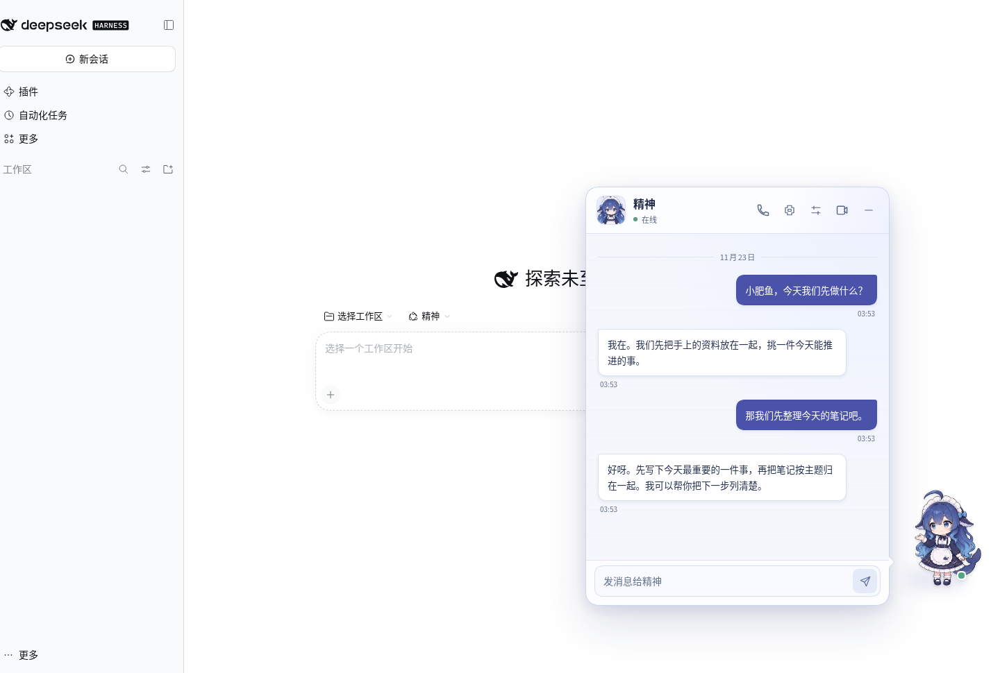

# 精神 · dsh-jingshen

**精神**是 fenglin 基于 SuperAgent 开发的个人 AI 助手，包名为 `dsh-jingshen`。在 DeepSeek Harness 的工作画幅里点一下小肥鱼，就能进入它的主会话。**0.4.5 适配 Harness 0.2.2-rc.5，要求 Node.js 24.9 或更高版本。** [下载 0.4.5 安装包](https://github.com/fenglin233o/dsh-jingshen/releases/download/v0.4.5/dsh-jingshen-0.4.5.tgz) · [发行说明与可选资产](https://github.com/fenglin233o/dsh-jingshen/releases/tag/v0.4.5)

比如你和小肥鱼商量周末去湖边，隔天又决定去书店。它可以把原来的安排改掉，在另一段会话里继续做这件事。支撑这种接续的是各会话共同使用的工作状态。主会话压缩后，已经取消的工作仍保持取消。

- **跟它聊天或打电话。** 主会话里的每条发言都经过精神决定后才交付。接通电话可以随时插话，默认在本机转写普通话，再用 Breeze 的「大肥鱼（迷糊版）」读出它发给你的话。[通话与连续视觉](docs/MEDIA.md)
- **让它参与项目。** 它可以借助工作会话、智能体团队和子代理推进事情。它在其他会话中参与发布时，回复旁会显示“精神”。[架构与会话协作](docs/ARCHITECTURE.md)
- **决定它可以做什么。** 你可以要求敏感操作先询问，或授予完全访问，也可以暂停、恢复和停止活动。它能提出并实施源码改动，分别记录验证、应用、运行加载和后续效果。[实现与验证](docs/IMPLEMENTATION.md)

设计取自《精神现象学》。模型、语言、工具和历史是起点，插件在具体经验里形成并修订判断。空闲给它重新考虑的机会，它可以发起一件事，也可以安静一会儿。[设计依据](docs/PHENOMENOLOGY.md)

0.4.5 的验收记录列出本次实际运行的宿主、平台、模型和语音条件。此前的真实 Breeze 合成结果归档在 0.4.3。[本版验证记录](docs/verification.json) · [0.4.3 验证档案](docs/verification-0.4.3.json)



## 安装与启动

Harness 中配置模型账户；安装包不包含任何模型密钥。

```sh
npm install -g @deepseek-ai/dsh@0.2.2-rc.5

# 仅在创建一个全新的 profile 时执行：
dsh --profile jingshen --from-default-profile web --dump-config
```

`--from-default-profile` 会重建 profile，已有配置升级时不要使用。

### 建议：使用独立源码目录

在 0.4.5 源码目录中构建并安装到自己的 profile。以下命令在该目录运行。

```sh
npm ci
npm run build
dsh plugin --profile jingshen add "link:$PWD"
```

这种方式让它改造的是你单独放置的源码与构建产物。启动独立监督进程：

```sh
node scripts/run.mjs --state-dir /绝对路径/jingshen-state -- dsh --profile jingshen --no-open
```

最后的 `--` 后是你确定的 Harness 启动命令。启动器会将 `JINGSHEN_STATE_DIR` 传给插件；插件设置中不要再覆盖成不同目录。状态目录必须放在源码目录外。Windows 下可将末尾命令写为 `node C:\绝对路径\dsh\lib\bin.js --profile jingshen --no-open`，避免以不可直接执行的 `.cmd` 作为子进程程序。

启动器保持进程运行，只在模型明确请求加载已经检验并应用的改动时重启 Harness。它不周期性下载、更新或强迫模型活动。按 Ctrl-C 结束启动器与其 Harness 子进程。

### 安装已构建的包

```sh
dsh plugin --profile jingshen add /绝对路径/dsh-jingshen-0.4.5.tgz
dsh --profile jingshen --no-open
```

此方式可直接使用会话、主动意向、工具、记忆与改动功能。没有独立启动器时，需要进程重启的激活会明确返回 `restart-required`。插件内修改可以通过原生 Plugin Manager 触发重新加载；是否成功以宿主回执为准。需要长期修改源码时，建议使用上面的独立目录安装方式，避免修改包管理器的缓存副本。

### 从上一版升级

沿用已有 profile。先停止旧进程，备份插件的 `stateDir` 和 Harness 会话数据。0.3.0 至 0.4.3 用户沿用 rc.5，0.2.0 用户先把宿主升级到 rc.5，再安装 0.4.5。以下示例中的 `jingshen` 请换成你原来的 profile 名。

```sh
dsh plugin --profile jingshen remove dsh-jingshen
dsh plugin --profile jingshen add /绝对路径/dsh-jingshen-0.4.5.tgz
```

新安装的默认状态目录为 `~/.local/share/dsh-jingshen/`。升级会沿用已有默认目录。继续使用原先的 `stateDir`，即可接回原来的主会话和 SQLite 记录。升级时会识别历史预设。插件管理器中应只有一个“精神”，包名和当前预设标识均为 `dsh-jingshen`。

## 使用

点击画幅上的小肥鱼，从右上角选择主会话模型，再在底部输入框发送消息。缩小窗口后，工作可以继续，新到达的发言计入未读。右上角的管理按钮打开事务、权限、暂停、恢复和记录。通话时小肥鱼在中央放大，麦克风、挂断和视觉仍可操作。

本人发来的消息和空闲唤醒，都可以形成零条、一条或多条公开发言。精神可以一次讲完整件事。它选择继续时，先交付这一条，再在新的模型步骤里结合已交付内容决定要不要做事、另发一条或停下。普通草稿由同一模型复核，模型可采纳、修订、等待或保持安静。在你开的项目、你请它开的会话、它自己创建的工作会话中，只要精神参与，该次发布同样经过它。参与委派的本地原生子代理和团队成员保留各自的会话身份与消息来源。原生聊天的每条已中介答复旁显示“精神”，可以按原生消息编号查到公开决定。专用通讯窗只展示实际交付的消息和你发的话。

工作时小肥鱼抱着笔记本打字。已授权的视频真正播放时才会出现玩手机的动作。它还可以自行做表情或收起表情。在完全访问下，空闲时也可以选择告诉你一件事，或自行行动而不通知。开启语音、调整音色、共享视频和连接已登录标签页的步骤见 [通话与视觉](docs/MEDIA.md)。

通话默认在宿主本机转写普通话，朗读使用 Breeze 云端的「大肥鱼（迷糊版）」。点通讯窗右上角的电话图标，打开右上角语音选项，点击“配置 Breeze 密钥”，通过 Harness 凭据保存专用的 `BREEZE_API_KEY`。只有通话接通后，已交付的发言正文才会发往 Breeze 进行语音合成。文字聊天无需这把密钥。你也可以手选设备普通话声线、继续使用原先显式配置的语音服务，或安装可选的本机 PrimeTTS 声线。[通话、凭据与费用](docs/MEDIA.md) · [迷糊版官方试听](https://breezeblue.ai/zh/voice-library/dafeiyu-dreamy-girl-voice-v8yud7hz7c9q2)

面板提供两种真实权限模式：

- **敏感操作询问**：默认模式，对应 Harness 的 `workspace-write` 权限；跨会话写操作和源码改动另经原生确认，原生文件与命令工具继续执行自己的权限检查。
- **完全访问**：对应 `danger-full-access`，让精神在宿主与当前系统账户能够提供的范围内使用工具、改动自身和配置的 Harness 源码。

主会话需要批准一项操作时，小肥鱼的通讯窗会显示宿主正在等待的请求。点击“允许一次”只放行这一次，点击“拒绝”会结束这次请求。缩小窗口后，鱼身边会提示待处理项；通话中也可直接处理。暂停会撤回尚未决定的请求。

权限变更要等待服务器返回已生效。失败或会话权限不一致会显示出来；不以按钮外观代替实际授权。这里的完全访问不创造操作系统管理员权限、模型服务权限或其他账户授权；同一身份拥有源码和文件写权限，也意味着这些应用层控制不是防篡改的隔离边界。

**暂停**保留待处理事务和意向并停止当前活动；**停止**撤回当前活动，已停止的事务不会因恢复按钮而自动复活。任务可以单独停止。记忆可接纳、拒绝、纠正或遗忘；模型自行形成的工作记忆保留模型来源，不会显示成本人已经确认。

暂停期间直接发送到原生会话的新消息会被阻止启动推理，并保留宿主的阻止记录；恢复不会自动重放这条消息，需要你重新发送或继续。

## 主动性怎样发生

本人新开的精神会话从第一条消息起就能接着正在做的事。一个会话中修订的做法或撤回的意向会影响其他参与会话的下一步。主会话遇到模型的上下文上限时，由 Harness 压缩对话历史；插件在下一次模型请求中提供当前的判断、有效意向及其来源。需要了解一次改变怎样发生时，可以通过会话和原生日志位置回看当时的经过。

模型可以基于尚未解决的事情形成意向、关注某个会话后续的本人消息，或者选择一个再次考虑的时点。事务结果、被关注会话中本人发来的新消息和它自己选择的再次考虑机会，可以唤醒主会话。其他会话中的模型回答仍可主动读取；当前 `watch` 不把所有模型输出都自动变成新唤醒。

在完全访问模式下，即使没有新消息、未决事项或明确问题，已选模型的空闲主会话也能得到一次开放的活动机会。`openIntervalMinutes` 默认 15 分钟，设为 0 可以关闭这类机会。模型可以从手头材料中形成问题、继续做事、拒绝本人提出的具体请求，或选择保持安静。已投递、已判断、已完成分别记录。重新启动后依据持久记录处理仍有效的机会。

### 团队与子代理

需要委派时，精神可以使用宿主的 `subagent` 从新上下文开始工作，或用 `subagent_fork` 带上已完成的轮次。子代理的消息和结果保留实际发送者。收到结果的精神会话可以采用、质疑、修订或搁置其中的判断。根会话启用官方“智能体团队”后，同一棵树还可共享任务板。成员共用检出目录，跨成员并行改动同一文件时要协调。根的团队开关、团队任务的认领、精神的持续意向分别由各自的状态管理。[rc.5 团队说明](https://github.com/deepseek-ai/deepseek-harness/blob/dsh-v0.2.2-rc.5/packages/team/agent-team/README.zh.md)

持续活动需要已配置的模型、运行中的 Harness 和相应调用资源。记忆、技能、工具和实现可以学习与修改；这不等于直接训练所用 API 模型的权重。

## 自身改造与恢复

`jingshen_change` 提供真实的候选改动、检查点、验证、应用、回退与激活操作。候选目录中的源码可由原生文件和 shell 工具编辑、构建、测试。验证通过后还会检查候选是否又被修改、源目录是否漂移，然后才应用。检查命令仍走原生工具权限。

文件应用、运行中版本加载与后续行为改善分别记录。独立启动器收到明确激活请求后，验证已应用版本、重启子进程，并等待新插件确认就绪。启动失败会停止并保留恢复资料，不无限重启。运行中启动器自身的代码要在重新启动该启动器后生效。

每次创建候选时，都在状态目录内保存一份不依赖插件加载的恢复脚本：

```sh
# 先停止相关 Harness / 启动器，然后检查这次改动：
node /状态目录/self-changes/改动ID/recover.mjs /状态目录 改动ID

# 检查后恢复其检查点：
node /状态目录/self-changes/改动ID/recover.mjs /状态目录 改动ID --rollback
```

后来产生的冲突改动不会被无声覆盖。当前检查点支持普通文件，不复制 `.git`、`node_modules`，拒绝符号链接和文件/目录类型互换；应用为逐文件原子写入，中途失败会保存日志供恢复，不能当作整个目录的原子事务。

异常退出可能留下 `self-changes/operation.lock` 或监督进程的锁。恢复工具会指出具体路径；先停止有关进程，检查锁记录并确认没有操作仍在使用它，再移除该锁。工具不会依据一个可能被系统复用的 PID 自动接管锁。

要把 Harness 本身纳入同样的改造过程，在插件设置中填写 **`harnessSourceRoot`**，指向你实际用于构建和启动的独立 Harness 源码目录。仅修改另一个未被启动命令使用的源码副本，不会改变正在运行的宿主。

## 数据、源码与验证

`stateDir` 内保存 `personal.sqlite`、会话工作目录、候选与检查点以及激活记录。原始会话日志由 Harness 保存。面板导出供查阅，不等同于完整备份；完整备份还要包含工作成果、状态目录及 Harness 会话数据。

插件源码、构建配置、测试与必要的 SuperAgent 源码均随包提供。`upstream/PROVENANCE.json` 记录上游提交及兼容改动；没有挂载上游的 GitHub/飞书监听器或团队管理界面。源码目录内可执行：

```sh
npm ci
npm run check
npm pack
```

具体验证结果与尚未验证的部分见 [实现与验证记录](docs/IMPLEMENTATION.md)。这是个人用途的独立改造，采用 MIT 许可证；来源见 [NOTICE](NOTICE)。
