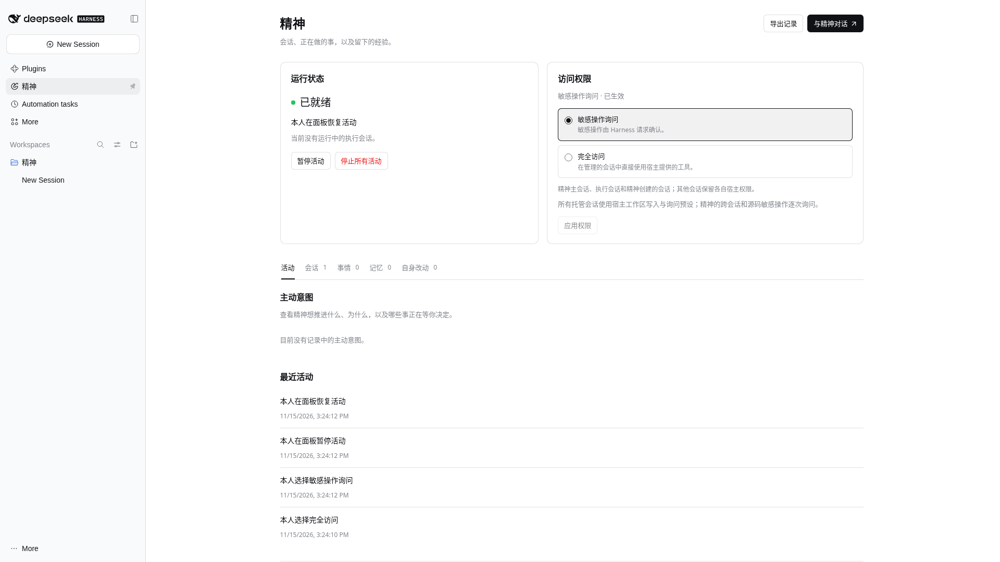

# 精神 · dsh-jingshen

作者：**fenglin**。当前验证范围为 Harness 本地 Web；Electron 桌面客户端尚未完成兼容验收。

个人使用的 DeepSeek Harness 插件，以 SuperAgent 的任务引擎、SQLite 存储与持久执行队列为基底，重新组织会话、经验、主动意向和自身改造。插件版本 **0.2.0**，目标宿主版本 **0.2.2-rc.3**，需要 Node.js **24.9+**。

它承认模型、语言、工具、已有历史和与你的关系已经构成丰富的起点。没有预写的人格、六阶段成长路线，也不要求每次工作都填写哲学表格。设计依据与解释边界见 [《精神现象学》对照](docs/PHENOMENOLOGY.md) 和 [架构说明](docs/ARCHITECTURE.md)。

## 公开源码与发行

作者：fenglin。源码与问题反馈：[fenglin233o/dsh-jingshen](https://github.com/fenglin233o/dsh-jingshen)。

本项目的 npm 名称为 `dsh-jingshen`，当前通过 GitHub Release 提供安装包；npm 上的 `dsh-spirit` 属于另一个项目。社区市场收录采用 dshmarket 的目录审核流程，提交申请与正式收录是两个状态。详情见 [市场发布说明](marketplace/README.md)。



## 安装与启动

Harness 中配置模型账户；安装包不包含任何模型密钥。

```sh
npm install -g @deepseek-ai/dsh@0.2.2-rc.3

# 仅在创建一个全新的 profile 时执行：
dsh --profile spirit --from-default-profile web --dump-config
```

`--from-default-profile` 会重建 profile，已有配置升级时不要使用。

### 建议：使用独立源码目录

解压 `dsh-jingshen-0.2.0-source.zip`，进入解压后的包目录：

```sh
npm ci
npm run build
dsh plugin --profile spirit add "link:/绝对路径/dsh-jingshen-0.2.0"
```

这种方式让它改造的是你单独放置的源码与构建产物。启动独立监督进程：

```sh
node /绝对路径/dsh-jingshen-0.2.0/scripts/run.mjs --state-dir /绝对路径/spirit-state -- dsh --profile spirit --no-open
```

最后的 `--` 后是你确定的 Harness 启动命令。启动器会将 `SPIRIT_STATE_DIR` 传给插件；插件设置中不要再覆盖成不同目录。状态目录必须放在源码目录外。Windows 下可将末尾命令写为 `node C:\绝对路径\dsh\lib\bin.js --profile spirit --no-open`，避免以不可直接执行的 `.cmd` 作为子进程程序。

启动器保持进程运行，只在模型明确请求加载已经检验并应用的改动时重启 Harness。它不周期性下载、更新或强迫模型活动。按 Ctrl-C 结束启动器与其 Harness 子进程。

### 从 GitHub Release 安装

```sh
dsh plugin --profile spirit add "https://github.com/fenglin233o/dsh-jingshen/releases/download/v0.2.0/dsh-jingshen-0.2.0.tgz"
dsh --profile spirit --no-open
```

### 安装已构建的包

```sh
dsh plugin --profile spirit add /绝对路径/dsh-jingshen-0.2.0.tgz
dsh --profile spirit --no-open
```

此方式可直接使用会话、主动意向、工具、记忆与改动功能。没有独立启动器时，需要进程重启的激活会明确返回 `restart-required`。插件内修改可以通过原生 Plugin Manager 触发重新加载；是否成功以宿主回执为准。需要长期修改源码时，建议使用上面的独立目录安装方式，避免修改包管理器的缓存副本。

### 从此前私用包升级

此前私用包名为 `dsh-spirit`；它与 npm 上同名的第三方项目无关。升级时先停用自己的旧包，在相同 `stateDir` 上启用本包，不同时运行两份。

### 从上一版升级

停止旧 profile，备份旧状态目录与 Harness 会话数据，再替换包：

```sh
dsh plugin --profile personal-spirit remove dsh-personal-spirit
dsh plugin --profile personal-spirit add "link:/绝对路径/dsh-jingshen-0.2.0"
```

继续使用原先的 `stateDir`。默认路径仍为 `~/.local/share/dsh-personal-spirit/`，主会话标识保持稳定，并保留旧预设 ID 的兼容声明。不要同时启用新旧两个插件操作同一状态目录。

## 使用

侧栏打开 **精神**，进入主会话并选择模型，然后直接对话。已有会话、事务会话和另外创建的会话可以并存。模型可以读取会话、发送有来源标记的消息、创建新会话，并从宿主真实模型目录选择模型和思考强度；不会暗中改变 Harness 的全局模型默认值。

面板提供两种真实权限模式：

- **敏感操作询问**：默认模式，对应 Harness 的 `workspace-write` 权限；跨会话写操作和源码改动另经原生确认，原生文件与命令工具继续执行自己的权限检查。
- **完全访问**：对应 `danger-full-access`，让精神在宿主与当前系统账户能够提供的范围内使用工具、改动自身和配置的 Harness 源码。

权限变更要等待服务器返回已生效。失败或会话权限不一致会显示出来；不以按钮外观代替实际授权。这里的完全访问不创造操作系统管理员权限、模型服务权限或其他账户授权；同一身份拥有源码和文件写权限，也意味着这些应用层控制不是防篡改的隔离边界。

**暂停**保留待处理事务和意向并停止当前活动；**停止**撤回当前活动，已停止的事务不会因恢复按钮而自动复活。任务可以单独停止。记忆可接纳、拒绝、纠正或遗忘；模型自行形成的工作记忆保留模型来源，不会显示成本人已经确认。

暂停期间直接发送到原生会话的新消息会被阻止启动推理，并保留宿主的阻止记录；恢复不会自动重放这条消息，需要你重新发送或继续。

## 主动性怎样发生

模型可以基于尚未解决的事情形成意向、关注某个会话后续的本人消息，或者选择一个再次考虑的时点。事务结果、被关注会话中本人发来的新消息和它自己选择的再次考虑机会，可以唤醒主会话。其他会话中的模型回答仍可主动读取；当前 `watch` 不把所有模型输出都自动变成新唤醒。

唤醒携带来源与理由，具体结果可以是行动、暂缓、询问、学习或不做。定时器只负责交付机会；它不会在固定时间自动更新插件，也不会因时间流逝虚构“精神发展”。发送进入收件箱、模型作出判断、事务完成是分别记录的状态。宿主不运行时不会调用模型，重新启动后依据持久记录处理仍有效的机会。

持续活动需要已配置的模型、运行中的 Harness 和相应调用资源。记忆、技能、工具和实现可以学习与修改；这不等于直接训练所用 API 模型的权重。

## 自身改造与恢复

`spirit_change` 提供真实的候选改动、检查点、验证、应用、回退与激活操作。候选目录中的源码可由原生文件和 shell 工具编辑、构建、测试。验证通过后还会检查候选是否又被修改、源目录是否漂移，然后才应用。检查命令仍走原生工具权限。

文件应用、运行中版本加载与后续行为改善分别记录。独立启动器收到明确激活请求后，验证已应用版本、重启子进程，并等待新插件确认就绪。启动失败会停止并保留恢复资料，不无限重启。运行中启动器自身的代码要在重新启动该启动器后生效。

每次创建候选时，都在状态目录内保存一份不依赖插件加载的恢复脚本：

```sh
# 先停止相关 Harness / 启动器，然后检查这次改动：
node /状态目录/self-changes/改动ID/recover.mjs /状态目录 改动ID

# 检查后恢复其检查点：
node /状态目录/self-changes/改动ID/recover.mjs /状态目录 改动ID --rollback
```

后来产生的冲突改动不会被无声覆盖。当前检查点支持普通文件，不复制 `.git`、`node_modules`，拒绝符号链接和文件/目录类型互换；应用为逐文件原子写入，中途失败会保存日志供恢复，不能当作整个目录的原子事务。

异常退出可能留下 `self-changes/operation.lock` 或监督进程的锁。恢复工具会指出具体路径；先停止有关进程，检查锁记录并确认没有操作仍在使用它，再移除该锁。工具不会依据一个可能被系统复用的 PID 自动接管锁。

要把 Harness 本身纳入同样的改造过程，在插件设置中填写 **`harnessSourceRoot`**，指向你实际用于构建和启动的独立 Harness 源码目录。仅修改另一个未被启动命令使用的源码副本，不会改变正在运行的宿主。

## 数据、源码与验证

`stateDir` 内保存 `personal.sqlite`、会话工作目录、候选与检查点以及激活记录。原始会话日志由 Harness 保存。面板导出供查阅，不等同于完整备份；完整备份还要包含工作成果、状态目录及 Harness 会话数据。

插件源码、构建配置、测试与必要的 SuperAgent 源码均随包提供。`upstream/PROVENANCE.json` 记录上游提交及兼容改动；没有挂载上游的 GitHub/飞书监听器或团队管理界面。源码目录内可执行：

```sh
npm ci
npm run check
npm pack
```

具体验证结果与尚未验证的部分见 [实现与验证记录](docs/IMPLEMENTATION.md)。这是个人用途的独立改造，采用 MIT 许可证；来源见 [NOTICE](NOTICE)。
